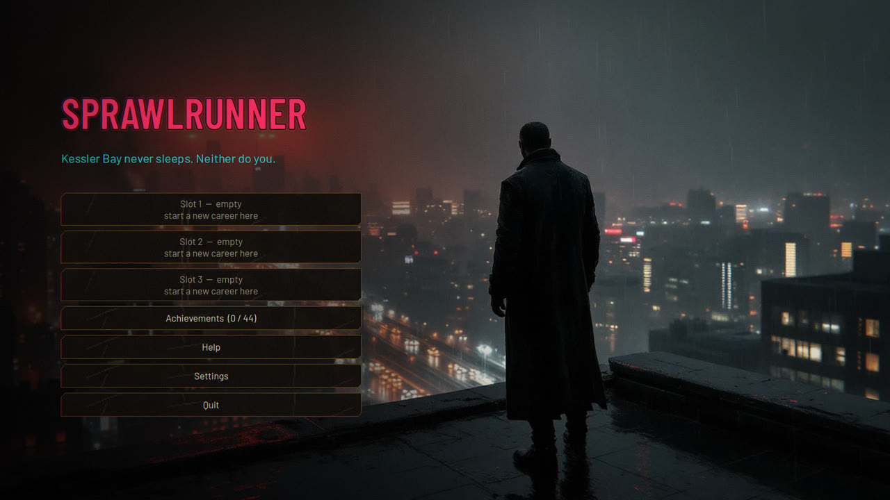
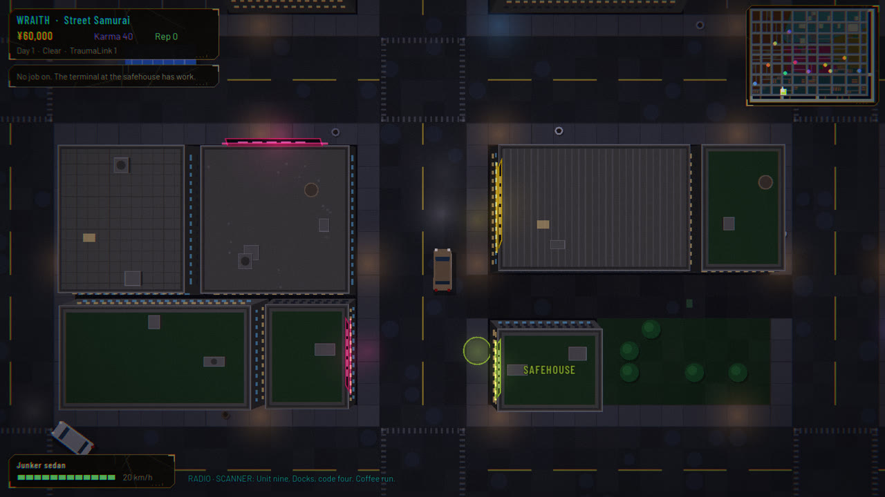
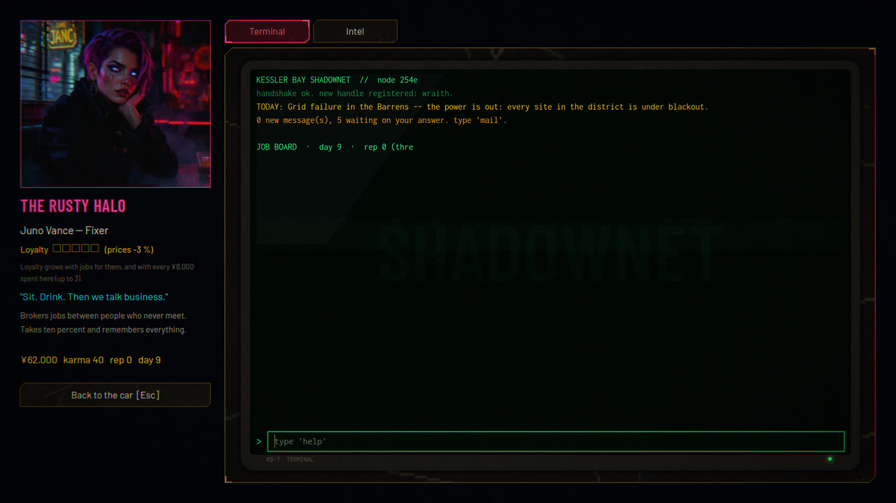
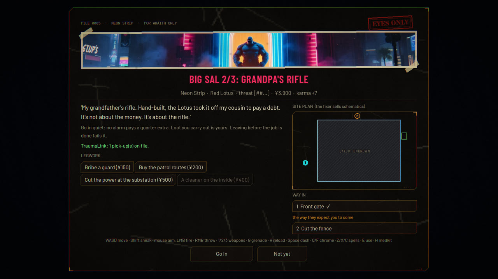
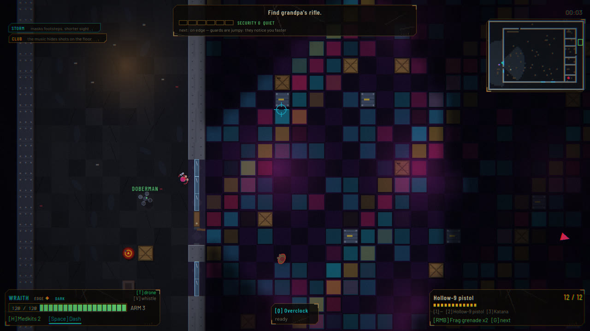
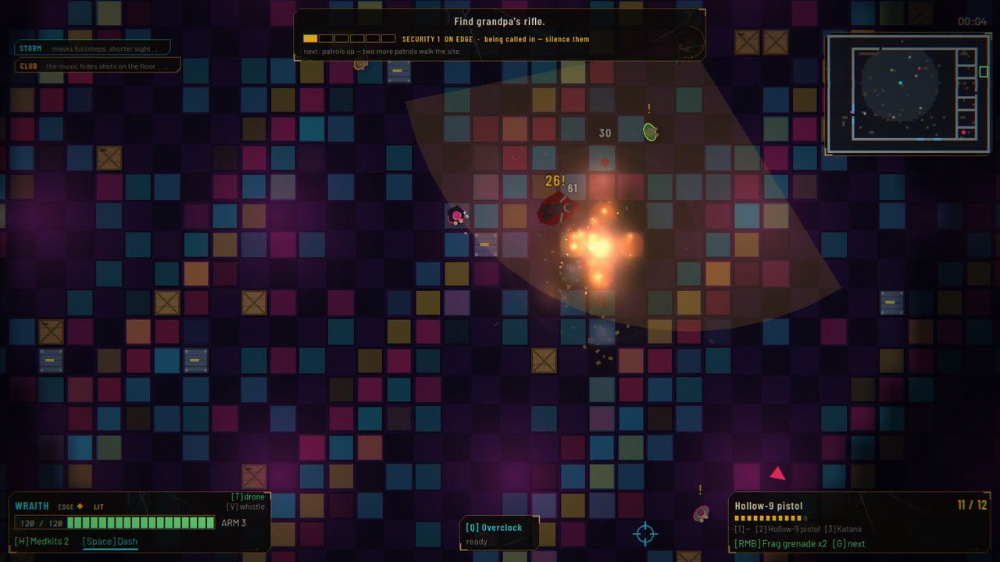
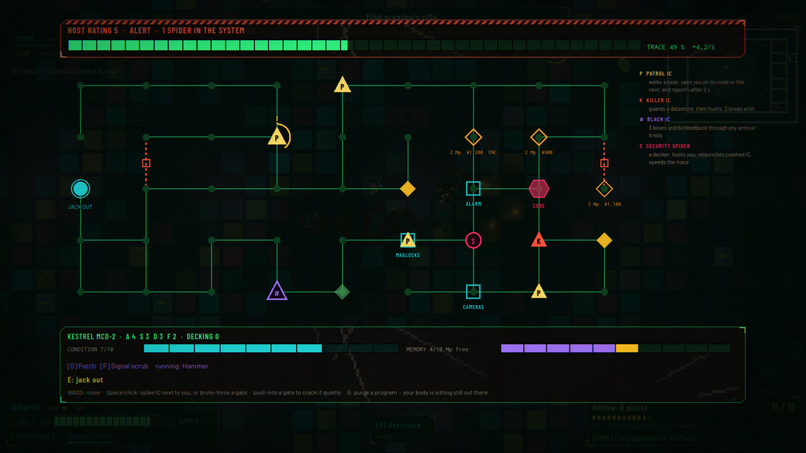

# Sprawlrunner

**Kessler Bay never sleeps. Neither do you.**

Sprawlrunner is an overhead cyberpunk action roguelike built in Godot 4.7 (.NET / C#),
inspired by the Shadowrun tabletop and the 16-bit Shadowrun games. The names, setting
and text are all original. You drive a rain-soaked bay city, visit your contacts, take
jobs from the terminal in your safehouse, and run them on foot in real time. Then you
spend the pay and karma on attributes, skills, chrome, gear, cars and the safehouse.
Careers are ironman: if you die on a run without a TraumaLink contract, that career is
over.

## Screenshots

| | |
|---|---|
|  |  |
| **The city.** Drive the street grid with arcade handling, traffic, the police scanner on the radio and a minimap of the districts. | **Contacts.** Fixers, fences, docs, deckers and talismongers, each with a painted portrait, a shop and a loyalty that grows. |
|  |  |
| **The briefing.** Pay, threat, legwork (bribe a guard, buy the patrol routes, cut the power) and the way in. | **Stealth.** Shared field of view for you and the guards, light and dark, noise, a storm and a club that hides your shots. |
|  |  |
| **The fight.** Guns, grenades, blades, chrome and spells against an alarm that keeps climbing and calls in more waves. | **The Matrix.** Jack in mid-run: dodge patrol, killer and black IC, crack gates and steal files before the trace finds you. |

## The loop

    safehouse terminal --> accept a job --> drive to the site --> run it
          ^                                                         |
          |                                                         v
    spend nuyen + karma <-- debrief (pay, karma, loot) <-- extract (or die)

- **Five districts**, from the Docks to the corporate Spire, each with its own threat
  range, site styles and street life: festivals, motorcades, street races, wrecks.
- **Sixteen job types**: eliminate, retrieve, destroy, datasteal, rescue, courier,
  investigate, plant, defend, kidnap, escort, bounty, hack, race and more.
- **Generated sites** on fourteen styles (warehouses, labs, clubs, tunnels, casinos,
  ships, hotels, rooftops and others). Walls take damage, doors and vaults can be
  broken, and grenades leave holes.
- **Archetypes**: street samurai, decker, mage, face and engineer, plus cyberware,
  spells, drones and Edge.
- **A living city**: gang turf and faction clocks, recurring Johnsons, rival crews,
  mail and calls from a storylet engine, your crew's moods, and several endings.
- Up to **three careers** side by side in save slots, saved after every run.

Every rule and number is in [`docs/DESIGN.md`](docs/DESIGN.md) and `src/Sim/Tables.cs`;
the Matrix has its own [`docs/MATRIX.md`](docs/MATRIX.md).

## Controls

On foot: **WASD** move, **Shift** sneak, **mouse** aim, **LMB** fire, **RMB** throw,
**1/2/3** weapons, **G** next grenade, **R** reload, **Space** dash, **Q/F** chrome,
**Z/X/C** spells, **E** use, **H** medkit.

Driving: **W/S** throttle and brake, **A/D** steer, **Space** handbrake, **H** horn,
**M** map, **E** to go in at a door.

All of these can be rebound in Settings, and gamepads work. The in-game **Help** (on the
title screen, both pause menus and the PDA) covers the rest. Sound is off until you
turn it on in Settings.

## Building and running

You need:

- [Godot 4.7.2 **.NET**](https://godotengine.org/download) (the plain build cannot load C#)
- .NET 8 SDK

The scripts are written for driving Windows Godot and `dotnet.exe` from WSL. Point them
at your Godot with `GODOT_DIR` or `GODOT`, either on the command line or in a
gitignored `.env` at the repo root:

    GODOT_DIR=/mnt/c/tools/Godot_v4.7.2-stable_mono_win64

Then:

    ./play.sh                   play
    ./play.sh --build           compile only
    ./play.sh --check           headless self-check, including a bot that plays whole jobs
    ./play.sh --shots           windowed walkthrough that writes screenshots to shots/
    bash scripts/export.sh DIR  Windows build to DIR

You can also open the project in the Godot .NET editor (`./play.sh --editor`) and press
Play.

## How it's made

Everything is built in code from a single `.tscn`: the city, the sites, the figures,
cars, effects, sound and music. The only files made outside the game are the painted
portraits, briefing banners, intro backdrops and spoken lines in `assets/`, which are
AI-generated (see `scripts/assets.sh`) and committed at game size. Each one is optional:
anything missing falls back to procedural art or silence. Nothing in the game touches
the network.

    src/Sim     the rules: career, city, levels, runs, combat, AI, Matrix, story (no Godot nodes)
    src/World   site and market generation
    src/View    drawing the city and runs: chunks, lights, fog, effects
    src/UI      screens, HUD, terminal, theme
    src/Core    screen flow, audio synthesis, input, assets
    tests/      the self-check run by ./play.sh --check

## Licence

Sprawlrunner is free to play, read, change and share, **but not to sell**.

- **Code**, scripts, tests and docs: [PolyForm Noncommercial 1.0.0](LICENSE). Use it
  for anything noncommercial, such as learning, modding, hobby projects or teaching.
  Keep the copyright notice.
- **Pictures, voices, video and screenshots** (`assets/art`, `assets/voice`,
  `assets/video`, `assets/help`, `docs/screenshots`):
  [CC BY-NC-SA 4.0](LICENSE-ASSETS). Credit the game, don't sell them, and share
  anything you build from them under the same terms.
- **Fonts** in `assets/fonts/`: SIL Open Font License 1.1, from their authors (their
  licences are beside them).

For commercial use, open an issue to ask.
